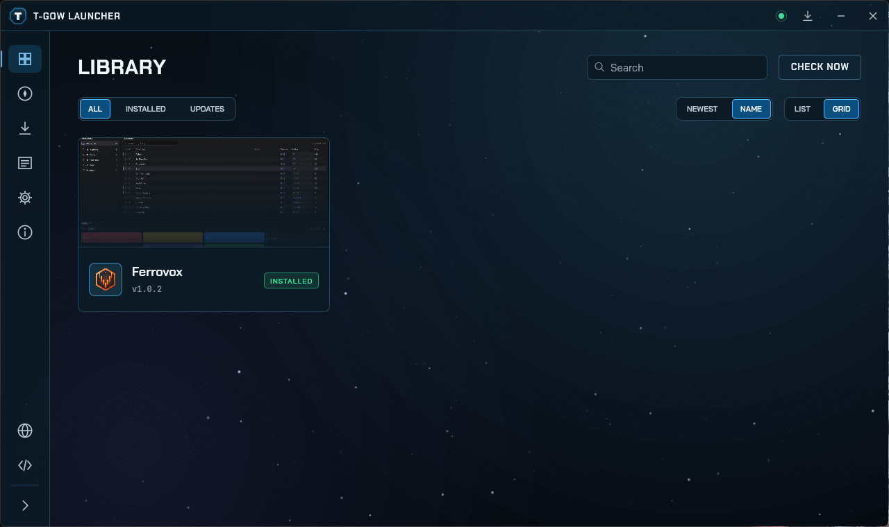
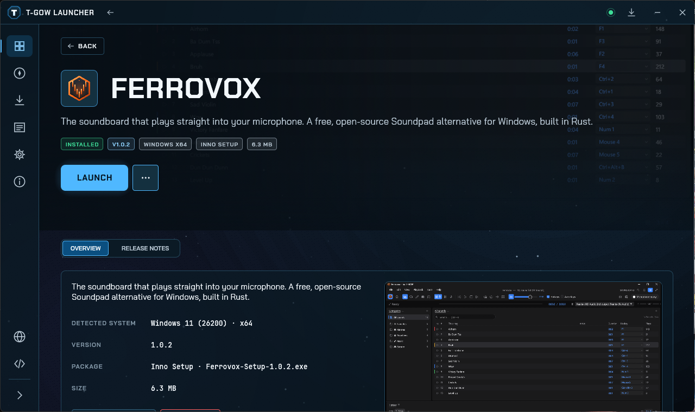
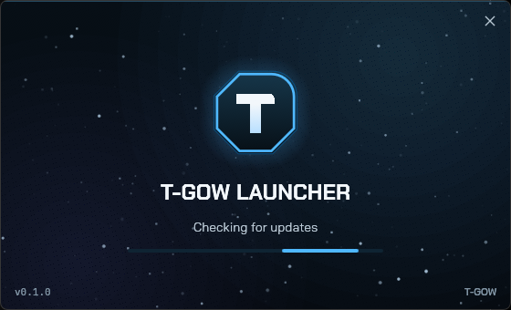
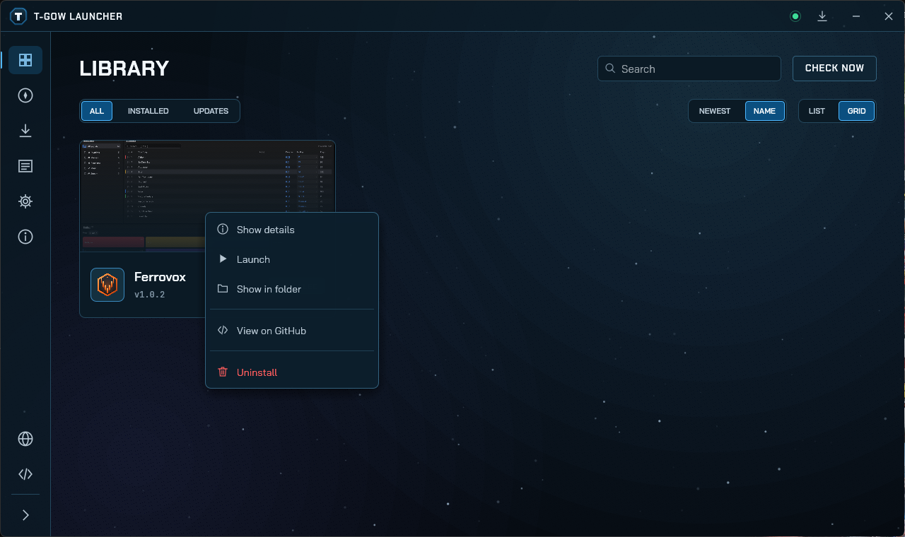
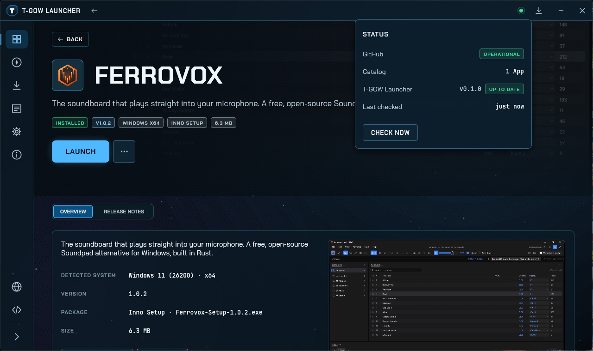
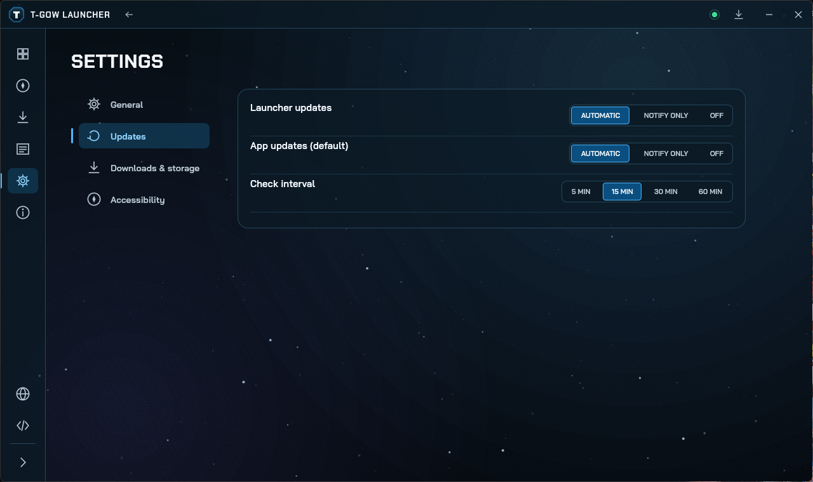
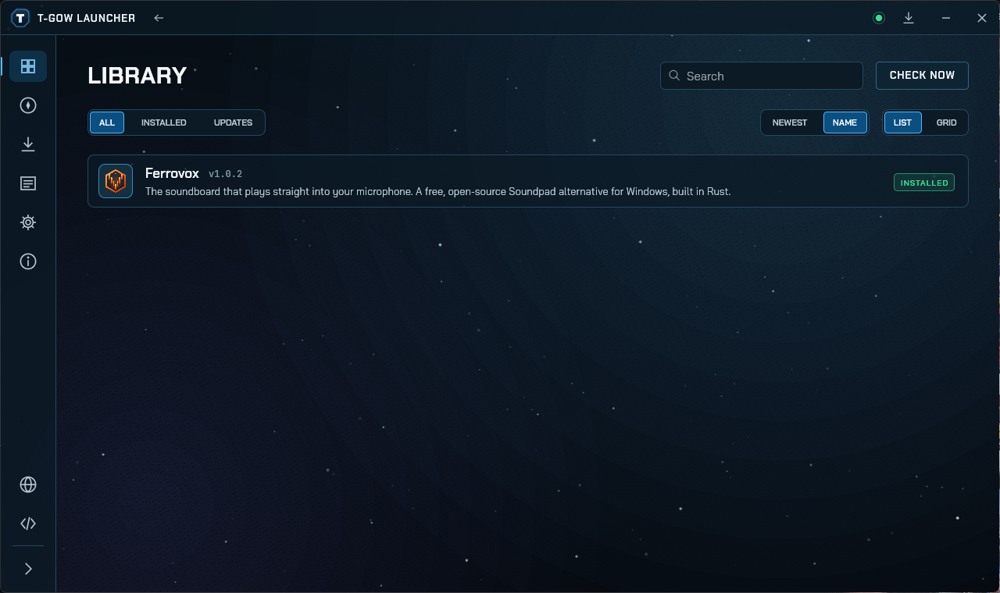
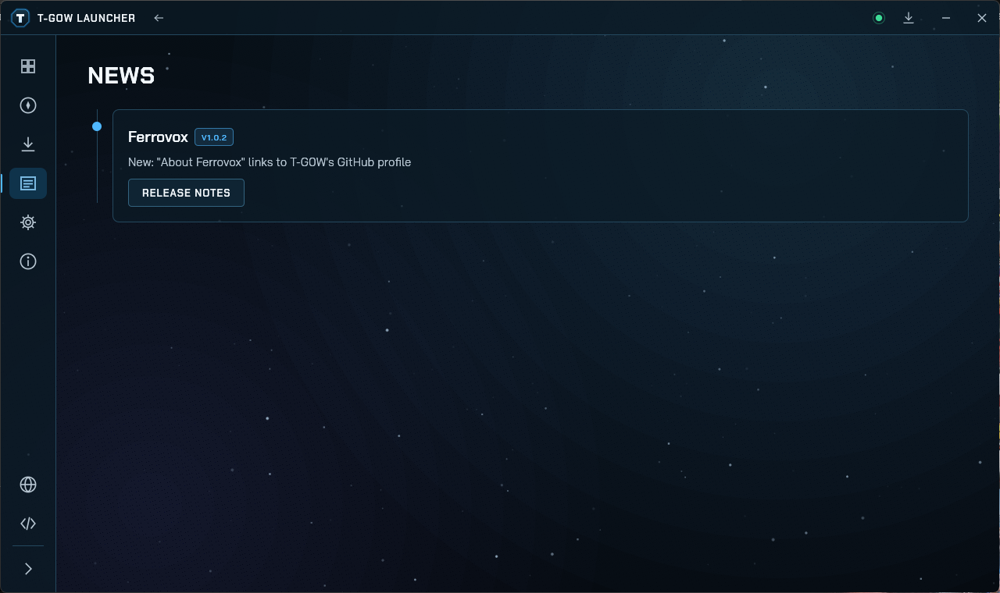
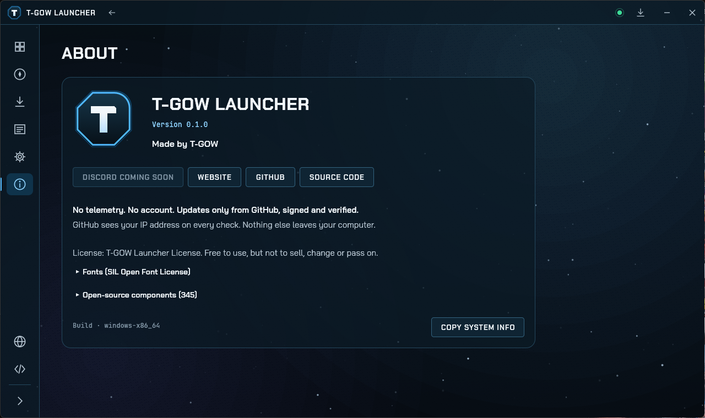

<p align="center">
  
</p>

<h1 align="center">T-GOW Launcher</h1>

<p align="center">
  <b>One place for every T-GOW project; finds the right build for your system, installs it and keeps it up to date, built in pure Rust.</b><br>
  Signed releases straight from GitHub, automatic updates with rollback, no administrator rights,<br>
  in one small native app for Windows and Linux. No account, no telemetry.
</p>

<p align="center">
  
  
  
  
  <a href="https://github.com/T-G0W/tgow-launcher/releases/latest"></a>
  <a href="https://github.com/T-G0W/tgow-launcher/releases"></a>
  <a href="https://github.com/T-G0W/tgow-launcher/issues"></a>
  <a href="https://t-gow.com"></a>
  
</p>

<p align="center">
  <a href="https://github.com/T-G0W/tgow-launcher/releases/latest"></a>
</p>

<br>

<p align="center">
  
  <br>
  <sub>The library with every T-GOW project, its version and its state: installed, update available, signed or not.</sub>
</p>

> [!NOTE]
> **T-GOW Launcher only installs what passes the signature check.** Every app comes from its own GitHub repository by T-G0W.
> Before anything is downloaded the release manifest is checked against an Ed25519 signature, and every file is checked against the size and SHA-256 in that manifest.

<p align="center">
  <a href="#features">Features</a> ·
  <a href="#feature-tour">Feature tour</a> ·
  <a href="#get-started">Get started</a> ·
  <a href="#adding-a-project">Adding a project</a> ·
  <a href="#under-the-hood">Under the hood</a> ·
  <a href="#build-from-source">Build</a> ·
  <a href="#bugs-ideas-and-feedback">Feedback</a> ·
  <a href="#license-and-credits">License</a>
</p>

<br>

<table>
  <tr>
    <td width="25%" valign="top">
      <h3>The right build, picked for you</h3>
      The launcher reads the real Windows build and CPU architecture, or the Linux distribution, and picks the matching package from each release, native first, emulated only as a fallback.
    </td>
    <td width="25%" valign="top">
      <h3>Updates itself and every app</h3>
      New releases install on their own as soon as an app is closed. The launcher replaces itself the same way and goes back to the last working version if a new one fails to start.
    </td>
    <td width="25%" valign="top">
      <h3>Signed or not at all</h3>
      No signature, no install. The launcher only talks to GitHub, through a fixed list of hosts, and verifies every byte it downloads.
    </td>
    <td width="25%" valign="top">
      <h3>Native and small</h3>
      One 13&nbsp;MB executable, no Electron, no runtime. The window is up in about 0.2 seconds and the whole app stays under 90&nbsp;MB of memory.
    </td>
  </tr>
</table>

<br>

## Features

Every screenshot is the real app, captured from a build of this repository.

<table>
  <tr>
    <td width="50%" valign="top">
      
      <br>
      <sub>An app page with logo, install state, the package picked for your system and a screenshot.</sub>
      <h3>One page per app</h3>
      Each app gets a page with its logo, tagline, release notes, the package picked for your system and a screenshot. Launch, update, show the folder or uninstall from here or from the menu next to the main button.
      <br><br>
      Apps that were installed before the launcher existed are found through their uninstall entry, so nothing has to be installed twice.
    </td>
    <td width="50%" valign="top">
      
      <br>
      <sub>The loading window checks GitHub before the launcher opens.</sub>
      <h3>Up to date before it opens</h3>
      It starts with a small loading window that checks GitHub. A new launcher version is downloaded, verified and installed right there, and the launcher restarts into it.
      <br><br>
      App updates install on their own in the background as soon as an app is closed.
    </td>
  </tr>
  <tr>
    <td width="50%" valign="top">
      
      <br>
      <sub>A right click on a card or a list row opens everything you can do with an app.</sub>
      <h3>Everything one click away</h3>
      Cards show the screenshot of each app as banner, with logo, name, version and install state always visible. Hovering fades the description in.
      <br><br>
      A right click opens details, launch or install, update, the folder, GitHub and uninstall.
    </td>
    <td width="50%" valign="top">
      
      <br>
      <sub>Status and downloads open as popups right under the title bar.</sub>
      <h3>Status and downloads at a glance</h3>
      The status dot shows whether GitHub is reachable, how many apps are in the catalog, whether the launcher is up to date and when it last checked.
      <br><br>
      The downloads button shows a badge while something runs and opens ongoing, waiting and finished jobs with progress and cancel.
    </td>
  </tr>
  <tr>
    <td width="50%" valign="top">
      
      <br>
      <sub>Update settings for the launcher and the default for all apps.</sub>
      <h3>Automatic, or your call</h3>
      Updates install automatically by default. Each app can switch to notify only or off, and the check interval goes from 5 to 60 minutes.
      <br><br>
      Several downloads run at once while installers run one after another, and an interrupted download picks up where it stopped.
    </td>
    <td width="50%" valign="top">
      
      <br>
      <sub>The library as a list, sorted by name or by newest release.</sub>
      <h3>Find things fast</h3>
      Search, filter by installed apps or available updates, sort by name or newest release, and switch between grid and list.
      <br><br>
      Ctrl+F searches, F5 checks now, Ctrl+J opens downloads, Ctrl+, the settings, and Alt+Left or the back button of the mouse goes back. Every control has a name and a focus ring for screen readers and the keyboard.
    </td>
  </tr>
  <tr>
    <td width="50%" valign="top">
      
      <br>
      <sub>News: the latest release of every app on a timeline.</sub>
      <h3>See what changed</h3>
      The news page lines up the latest release of every app with its notes, in German or English, depending on your language.
    </td>
    <td width="50%" valign="top">
      
      <br>
      <sub>About: version, links, privacy promise and every bundled open-source component.</sub>
      <h3>Nothing hidden</h3>
      The About page links the website and GitHub, lists all crates the launcher is built from with their licenses, and copies your system info for bug reports in one click.
    </td>
  </tr>
</table>

### Feature tour

- **Catalog:** every repository of T-G0W with the `tgow-launcher` topic and a signed release, read with one GitHub API request and an ETag cache; tags and manifests come through release downloads, which do not count against the API limit.
- **Detection:** Windows build and real architecture, also for x64 apps on ARM64; Linux distribution, glibc or musl, Flatpak and immutable systems.
- **Installing:** per user and without administrator rights; portable builds, ZIP, tar.gz, AppImage, Inno Setup, NSIS, MSI and Flatpak; archives are checked for paths that leave the target folder.
- **Updates:** automatic by default, per app automatic, notify only or off; the launcher updates itself and rolls back after two failed starts.
- **Downloads:** several at once, resumable, cancellable, checked against size and SHA-256 before anything runs.
- **Interface:** slightly rounded controls, a loading window, popups for status and downloads, context menus, back navigation, animations that can be switched off.
- **Everyday comfort:** system tray, start with the system, single instance, `tgow://` links that open an app page, German and English.

<br>

## Get started

1. Download **`tgow-launcher-<version>-windows-x64-portable.exe`** (or `windows-arm64`) from the [releases page](https://github.com/T-G0W/tgow-launcher/releases/latest) and run it.
2. Choose **Install** to put it into your user profile with a Start menu entry, or **Run without installing**.
3. Pick an app in the library and click **Install**. Updates take care of themselves from then on.

On Linux, unpack **`tgow-launcher-<version>-linux-x86_64.tar.gz`** and start `tgow-launcher`.

> [!TIP]
> Windows SmartScreen may show "Unknown publisher" the first time, because the launcher is not signed with a paid code-signing certificate. Choose **More info › Run anyway**.

Settings and caches live in `%LOCALAPPDATA%\T-GOW Launcher`, apps in `%LOCALAPPDATA%\Programs\T-GOW`. Put an empty `portable.txt` next to the executable to keep everything in a folder beside it instead. On Linux the launcher follows the XDG folders.

<br>

## Adding a project

A repository of T-G0W shows up in the launcher when it has the `tgow-launcher` topic and its latest release carries a signed `tgow-release.json`.

Name every asset `<app>-<version>-<os>-<arch>[-setup|-portable].<ext>`, for example `ferrovox-1.1.0-windows-x64-setup.exe`, `ferrovox-1.1.0-windows-arm64-portable.zip` or `ferrovox-1.1.0-linux-x86_64.AppImage`. The launcher picks the asset for the native architecture first and falls back to emulation.

For the library, put a square logo at `assets/logo-512.png` and a screenshot at `docs/images/<app>-main.png` into the repository. The launcher shows them on the card and the app page. Icons and hero images named in the signed manifest take precedence.

Call the reusable workflow from the tag workflow once the build jobs have uploaded their artifacts and the GitHub release for the tag exists:

```yaml
release:
  needs: build
  uses: T-G0W/tgow-launcher/.github/workflows/tgow-release.yml@<commit>
  with:
    app: ferrovox
    name: Ferrovox
    artifacts: "*"
    installer: inno
  secrets:
    TGOW_SIGNING_KEY: ${{ secrets.TGOW_SIGNING_KEY }}
```

It writes `tgow-release.json`, signs it and uploads it with `SHA256SUMS.txt` to the release. The same steps run locally with `cargo run -p tgow-release -- manifest ...` and `sign`.

<br>

## Under the hood

- **UI:** [egui](https://github.com/emilk/egui) / eframe on OpenGL with wgpu as fallback, a custom widget layer with the octagon corner of the logo, AccessKit for screen readers, Chakra Petch, Bai Jamjuree and JetBrains Mono.
- **Network:** [ureq](https://github.com/algesten/ureq) with rustls and the platform certificate verifier, no async runtime, a fixed allowlist of five GitHub hosts and redirects checked one by one.
- **Trust:** Ed25519 signatures with ed25519-compact, SHA-256 for every file, strict manifest checks for paths, sizes and versions.
- **Windows integration:** real architecture through `IsWow64Process2`, uninstall entries in the registry, a tray icon, a named pipe for the single instance and `self-replace` for updates.
- **Tooling:** everything is Rust, including `cargo xtask` for the checks and `tgow-release` for manifests and signatures.

<br>

## Build from source

Requirements: Rust (stable, MSVC toolchain on Windows).

```bash
cargo run
```

```bash
cargo test --workspace
```

A release binary without the paths of your machine, checked afterwards for home directory paths and email addresses:

```bash
cargo xtask dist
```

Checks used in CI:

```bash
cargo fmt --all --check
cargo clippy --workspace --all-targets -- -D warnings
cargo xtask nocomments
cargo xtask licenses --check
cargo deny check
```

Pushing a tag such as `v0.1.0` builds Windows x64, Windows ARM64 and Linux x86_64, signs the manifest and publishes the release on GitHub Actions.

<br>

## Privacy

T-GOW Launcher sends no telemetry and needs no account. It only talks to GitHub, which sees your IP address when the launcher checks for updates. Nothing else leaves your computer.

<br>

## Bugs, ideas and feedback

Please use **[GitHub Issues](https://github.com/T-G0W/tgow-launcher/issues)** for everything you would like to see fixed, added or changed.

<p align="center">
  <a href="https://github.com/T-G0W/tgow-launcher/issues/new?template=bug_report.yml"></a>
  &nbsp;
  <a href="https://github.com/T-G0W/tgow-launcher/issues/new?template=feature_request.yml"></a>
</p>

- **Bugs:** what happened, what you expected, and the system info from **About › Copy system info**.
- **Ideas and changes:** new features, things that feel awkward, missing package formats or systems.
- Take a quick look at the [open issues](https://github.com/T-G0W/tgow-launcher/issues) first. If someone already asked for the same thing, a thumbs-up reaction is enough and helps to prioritise.

Issues are welcome in English or German. Security problems go through private reporting instead, see [SECURITY.md](SECURITY.md).

<br>

## License and credits

T-GOW Launcher is © 2026 T-GOW, all rights reserved, under the [T-GOW Launcher License](LICENSE).

- **Allowed:** download it from this repository or its releases, install it and use it for free, read the source.
- **Not allowed:** selling it, changing or rewriting it, building on it, or passing it on to others.

The open-source components inside keep their own licenses.

The fonts Chakra Petch, Bai Jamjuree and JetBrains Mono are used under the SIL Open Font License 1.1. The licenses of all bundled crates are collected in [`THIRD-PARTY-LICENSES.txt`](THIRD-PARTY-LICENSES.txt), generated with `cargo xtask licenses`.

<p align="center"><sub>Made by T-GOW · <a href="https://t-gow.com">t-gow.com</a></sub></p>
